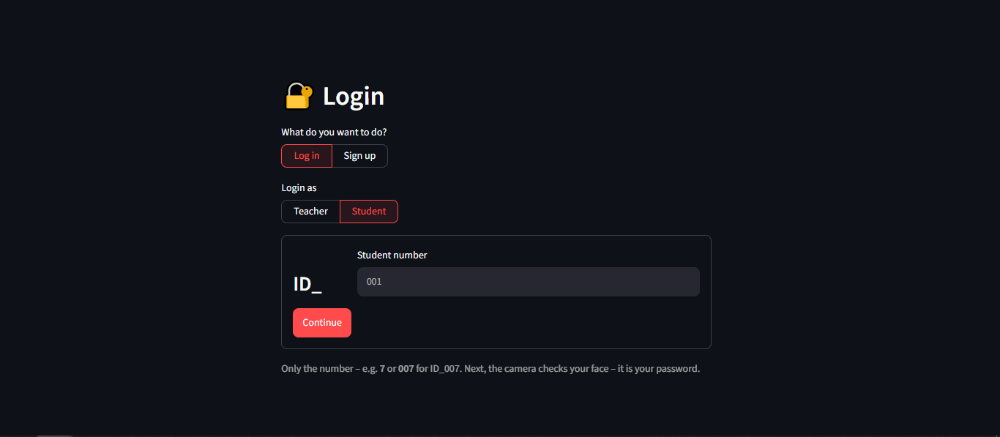
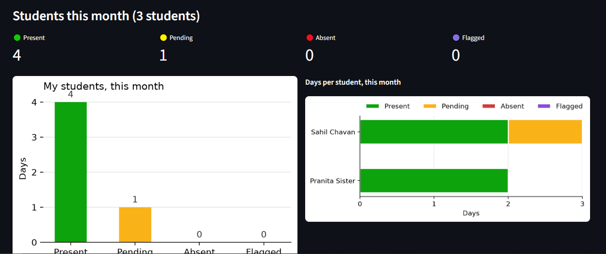
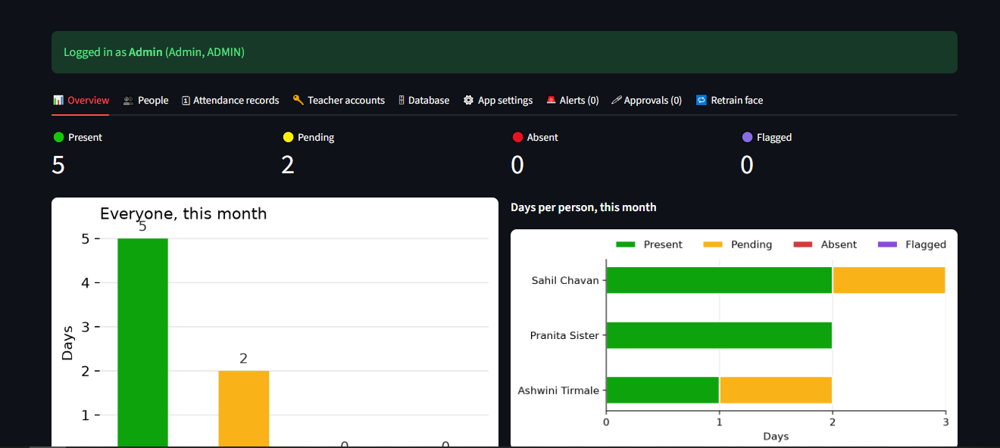

# 🙂 AI Attendance Management

**Face-recognition attendance for colleges – your face is your password.**
Students and teachers sign up with their face, log in with it and mark their own attendance from
their phone. Location and Wi-Fi checks stop "attendance from home", and an admin dashboard manages
everything.

`Python` · `Streamlit` · `InsightFace (buffalo_s)` · `OpenCV` · `SQLite` / `Supabase (Postgres)` · runs on CPU

---

## ✨ Features

**Face recognition**
- Sign-up takes **3 face photos automatically** (live camera, no clicking) – or Manual mode.
- **Login with the face**: students type only their number (`ID_` + `7`), then the camera checks that
  the face really belongs to that ID.
- Attendance is marked only if the camera sees the **logged-in person's own face**.

**Attendance**
- **Time In / Time Out** with a separate **cooldown for students and teachers**.
- Status per day: **Present**, **Pending**, **Absent**, **Flagged** (waiting for a teacher's review).
- Charts, monthly summaries and **Excel download**.

**Anti-cheating**
- **Geofence**: the average of 3 GPS readings must be inside the college circle.
- **Fake-GPS detection**: identical readings, round accuracy values, impossible travel speed
  (> 150 km/h), two students on exactly the same spot.
- **College Wi-Fi rule**: only IPs from the college network (single IPs or ranges).
- Suspicious marks are **flagged** and reviewed by the class teacher on a **map** (Approve / Reject).
- **Teacher identity check**: if a student's face appears in a teacher sign-up, the sign-up is cancelled,
  the student account is **frozen** and the admin gets an **alert**.

**Accounts and roles**
- **Admin** (logs in through the teacher form), **Teacher** (username + password),
  **Student** (number + face).
- New sign-ups need **approval** (admin, or the student's class teacher):
  Approve / **Reject login** (answers "Invalid ID", can be re-approved) / Delete all data.
- **One login account per teacher**, passwords stored only as salted **PBKDF2** hashes.
- **Stay logged in** after a reload (secure cookie token, only its hash is stored).

**Admin dashboard**
- People (Year + **Branch**, teacher classes), attendance records, teacher accounts, alerts, approvals.
- **App settings**: capture mode, cooldowns, **branch list**, college location (📍 use my current
  location), allowed Wi-Fi IPs (🌐 use my current IP), GPS check on/off.
- **Database tab**: switch between **offline (SQLite)** and **online (Supabase)**, **Upload / Download**
  sync (never deletes), view every table.

---

## 📸 Screenshots

> Add your own screenshots to `docs/screenshots/` and they appear here.

| Login | Mark attendance | Admin dashboard |
|---|---|---|
|  |  |  |

---

## 🧠 How it works

1. **InsightFace `buffalo_s`** finds the face and turns it into **512 numbers** (an *embedding*).
   **CLAHE** evens out the lighting first.
2. Two photos of the same person give similar embeddings. Their **cosine similarity** (dot product of
   the normalised vectors) is **≥ 0.5** for the same person.
3. For each mark, the browser sends **3 GPS readings, 2 seconds apart** (a small custom Streamlit
   component). The app checks the geofence, fake-GPS signs and the Wi-Fi IP.
   Hard failures **block**, suspicious ones **flag**.
4. Everything is stored in **SQLite** on a laptop or **Supabase** in the cloud, behind the same
   functions, so the app doesn't care which one is used.

| Check | Result |
|---|---|
| Outside the college geofence | blocked |
| Face not recognised | blocked |
| Wi-Fi required and not the college IP | blocked |
| 3 identical GPS readings / round accuracy / impossible travel / same spot as another student | flagged for review |

---

## 🚀 Quick start

```bash
git clone https://github.com/<your-username>/<your-repo>.git
cd <your-repo>
python -m venv .venv
# Windows: .venv\Scripts\activate      macOS / Linux: source .venv/bin/activate
pip install -r requirements.txt
streamlit run app.py
```

- The first start downloads the face model (~120 MB, kept small in `models/`).
- Without any secrets the app uses a local `data.db`, with the admin login **admin / admin123**
  (typed into the **Teacher** login).
- Camera and GPS work on **localhost** or **https** only.
- Optional: copy `.streamlit/secrets.toml.example` to `.streamlit/secrets.toml` and fill it in.

## ☁️ Deploy (Streamlit Community Cloud + Supabase)

Step by step in **[database.md](database.md)**:
1. Create the Supabase tables (one SQL script).
2. Add the secrets.
3. Upload your local data.
4. Deploy `app.py` on share.streamlit.io.

---

## 🗂 Project structure

```
├── app.py                   # the app (pages, dashboards, sign-up, login)
├── assets/
│   ├── face_engine.py       # InsightFace model, CLAHE, embeddings, matching
│   ├── live_camera.py       # live webcam component (frames to Python)
│   ├── auto_capture.py      # automatic photo / confirmation rules
│   ├── browser_location.py  # 3 GPS readings from the browser
│   ├── location_checks.py   # geofence, fake-GPS and Wi-Fi checks (plain functions)
│   ├── attendance_rules.py  # Time In / Time Out / cooldown / status
│   ├── auth.py              # password hashing, admin login, login sessions
│   ├── browser_cookie.py    # stay-logged-in cookie
│   └── storage.py           # SQLite + Supabase stores, settings, sync
├── tests/                   # pytest + Streamlit AppTest (simulated camera frames and GPS)
├── database.md              # going online step by step
├── requirements.txt / packages.txt
└── .streamlit/secrets.toml.example
```

## ✅ Tests

```bash
python -m pytest tests -v
```

The tests simulate camera frames and GPS readings with Streamlit's `AppTest`. They use temporary
files only and never touch real data or the online database.

---

## 🔒 Security notes
- Teacher passwords: salted **PBKDF2-SHA256** hashes. Login cookies: only a **SHA-256 hash** of the
  token is stored.
- Supabase tables have **Row Level Security** on. The app uses the private service key from the
  secrets, which are **never committed** (`.gitignore`).
- Faces are personal data: share the app only with your college.

## ⚠️ Limits
- GPS and IP can still be faked by a determined person (e.g. a VPN). The checks make cheating harder
  and leave evidence for the teacher; the face check is the main protection.
- The free Streamlit Cloud tier has ~1 GB memory – fine for a class, not for hundreds of people at the
  same second.

---

## 👤 Author
**Sahil Chavan** – [GitHub](https://github.com/sahiiil-c) · [LinkedIn](https://linkedin.com/in/sahiiilc)

## 📄 License
Choose a license before publishing (for example **MIT**) and add a `LICENSE` file.
